# Laboratório de Processamento Digital de Imagens

Laboratório **desktop, offline e interativo**, desenvolvido em **Python** para explorar operações de Processamento Digital de Imagens (PDI) em **escala de cinza de 8 bits (0–255)**. O sistema permite abrir imagens, configurar parâmetros, aplicar algoritmos e comparar o resultado à imagem original.

O projeto foi desenvolvido como atividade acadêmica da disciplina de Processamento de Imagens da **Universidade Federal de Rondônia (UNIR)**.

## Interface

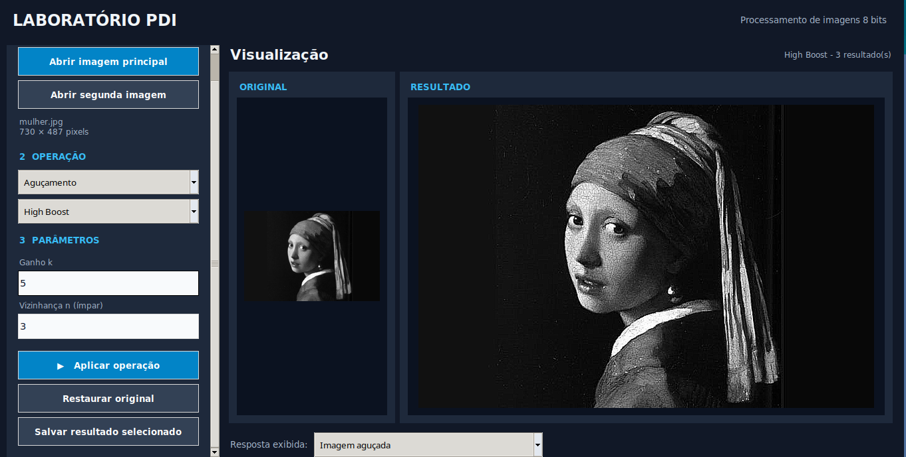

A interface foi construída com **Tkinter**. O painel lateral reúne seleção das imagens, operação e parâmetros, com rolagem vertical. A área principal apresenta o original e o resultado; quando houver múltiplas respostas, é possível selecionar qual visualizar e salvar.

Na captura acima, o **High Boost** foi aplicado com ganho `k = 5` e vizinhança `n = 3 × 3` em uma imagem distinta das utilizadas nos painéis demonstrativos abaixo.

## Funcionalidades

| Grupo | Operações | Parâmetros principais |
|---|---|---|
| Operações algébricas | Dissolve cruzado uniforme e não uniforme | Coeficiente `α` |
| Intensidade | Negativo, limiarização, alargamento de contraste, gamma e logaritmo | Limiar `T`, expoente `γ` |
| Histogramas | Expansão e equalização | Intensidades mínima/máxima, distribuição acumulada |
| Filtragem espacial | Média e mediana | Vizinhança `n × n` |
| Contraste adaptativo | Realce pela média e desvio-padrão locais | Constante `c`, vizinhança `n × n` |
| Detecção de bordas | Roberts, Sobel, Kirsch e Laplaciano | Máscaras direcionais, respostas intermediárias |
| Aguçamento | Laplaciano e High Boost | `c`, ganho `k` e vizinhança `n` |
| Convolução genérica | Máscara arbitrária `n × m` e offset | Coeficientes, offset, tratamento de bordas |

Os algoritmos são implementados nos módulos Python do projeto. **Pillow** é usado para leitura, gravação e exibição; **NumPy** representa e manipula as matrizes; **Tkinter** constrói a interface. Não são utilizadas funções de biblioteca que implementem diretamente os filtros ou detectores exigidos na avaliação.

## Exemplos de processamento

As montagens a seguir foram geradas com os algoritmos do laboratório utilizando uma imagem de teste. Alguns ensaios usam versões derivadas dela, com baixo contraste ou ruído sintético, para tornar o efeito das operações mais evidente.

### Operações algébricas e transformações de intensidade

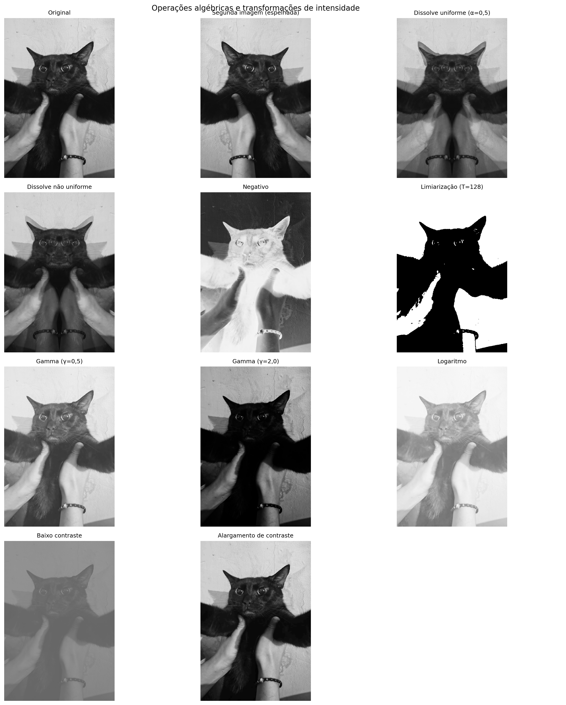

O dissolve uniforme combina duas imagens usando um valor constante de `α`; o não uniforme varia a mistura horizontalmente. Negativo inverte as intensidades, limiarização transforma o resultado em preto e branco, gamma modifica tons intermediários e logaritmo expande proporcionalmente intensidades baixas.

### Expansão e equalização de histograma

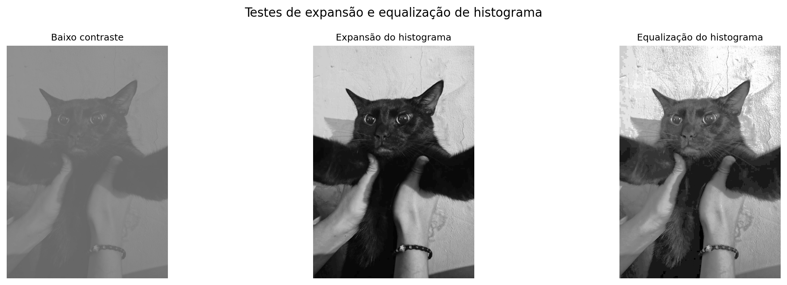

A **expansão** redistribui linearmente as intensidades entre 0 e 255; a **equalização** usa a função de distribuição acumulada (CDF) para mapear os níveis de cinza. O exemplo utiliza uma imagem cuja faixa tonal foi comprimida artificialmente.

### Filtragem: média e mediana

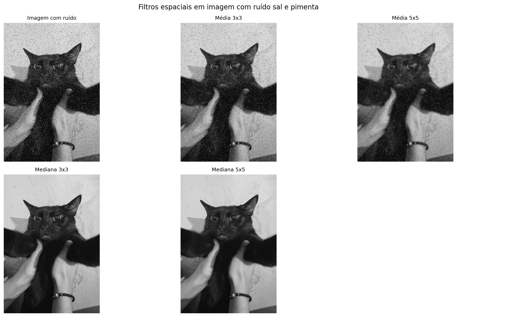

Filtros com janelas de `3 × 3` e `5 × 5` foram comparados sobre uma imagem com **ruído sal e pimenta sintético**. A média suaviza intensidades e tende a borrar contornos; a mediana é mais resistente a valores extremos isolados.

### Contraste adaptativo

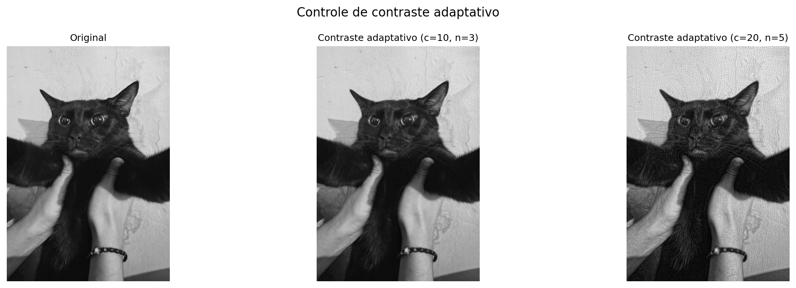

O realce depende da **média** e do **desvio-padrão locais** de cada vizinhança. Os exemplos empregam `c = 10, n = 3` e `c = 20, n = 5`. Valores elevados podem intensificar ruídos e saturar intensidades.

### Detecção de bordas

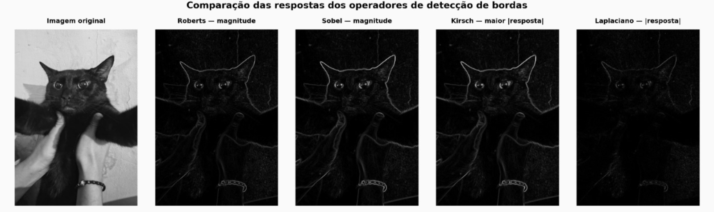

A comparação apresenta, sobre a mesma imagem, a **magnitude** dos operadores Roberts e Sobel, a maior resposta em módulo das oito máscaras de Kirsch e o módulo da resposta Laplaciana. As imagens foram normalizadas individualmente para visualização, portanto seus brilhos não devem ser interpretados como magnitudes diretamente comparáveis.

O sistema também disponibiliza as respostas **Gx**, **Gy** e **magnitude** para Roberts e Sobel, além das **oito direções** de Kirsch:

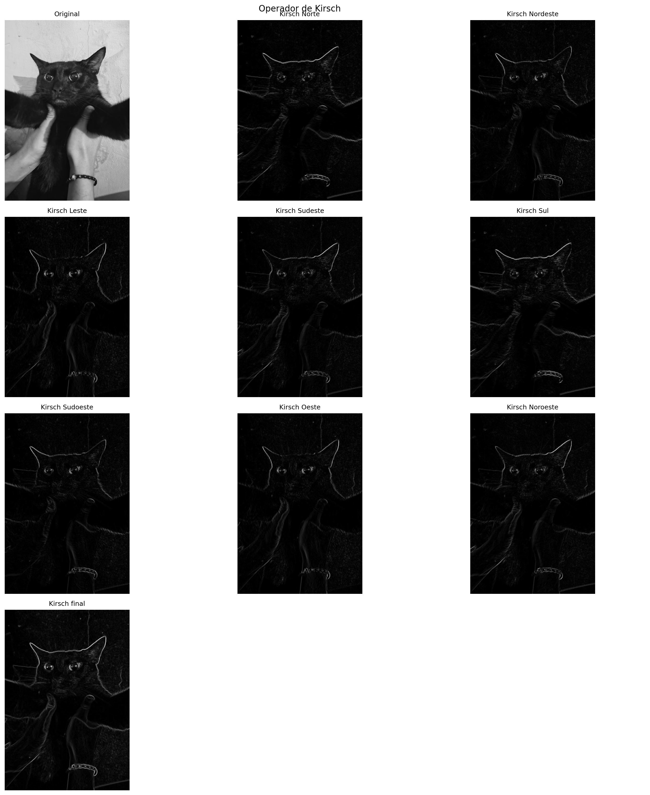

### Aguçamento Laplaciano e High Boost

| Aguçamento Laplaciano | High Boost |
|---|---|
| 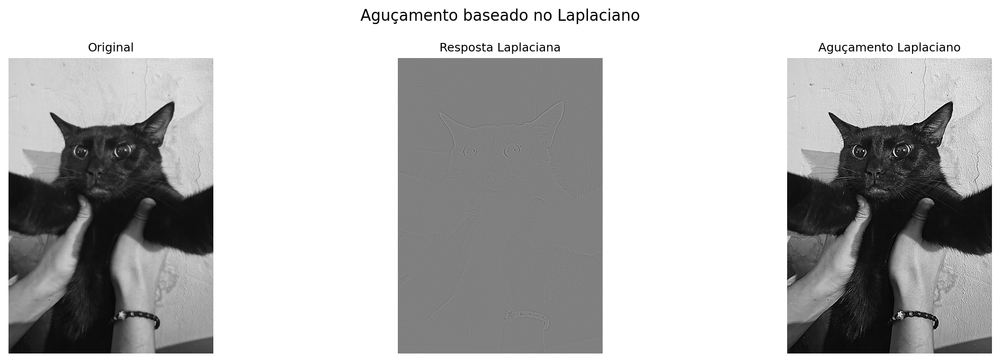 | 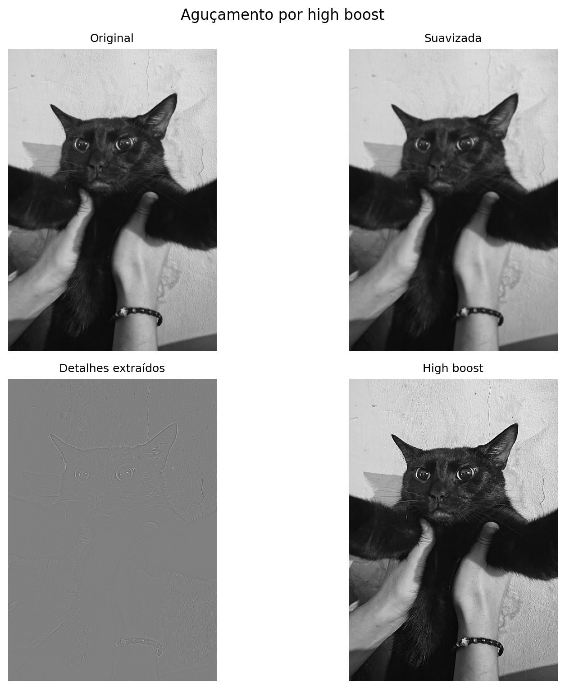 |

No **Laplaciano**, a resposta de segunda derivada é combinada com a imagem original (`c = 1` no exemplo). No **High Boost**, os detalhes são extraídos pela diferença entre a imagem original e uma versão suavizada, e então amplificados (`k = 1,5`, `n = 3` no exemplo).

### Convolução genérica: testes da avaliação

**Aguçamento com `c` e `d`:**

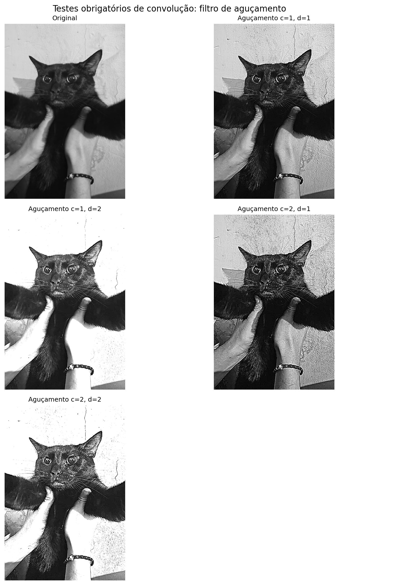

Máscara de teste:

```text
-c     -c      -c
-c   8c+d     -c
-c     -c      -c
```

Foram testados os pares `(c, d) = (1,1), (1,2), (2,1), (2,2)`. A soma dos coeficientes da máscara é `d`.

**Relevo:**

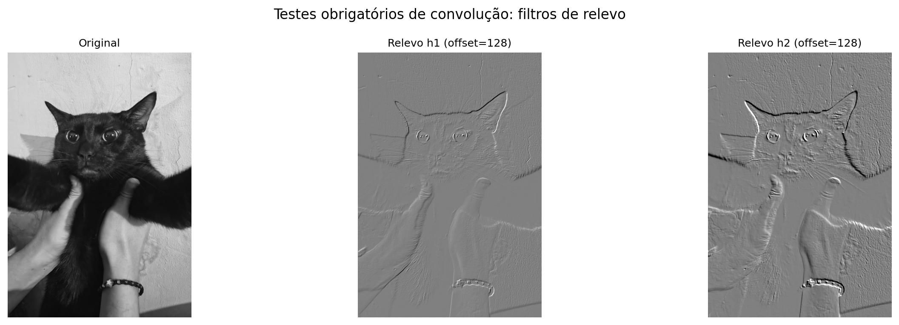

Aplicação das máscaras `h1` e `h2` do enunciado, com `offset = 128` para centralizar visualmente respostas positivas e negativas em torno do cinza médio.

**Máscaras adicionais de bordas:**

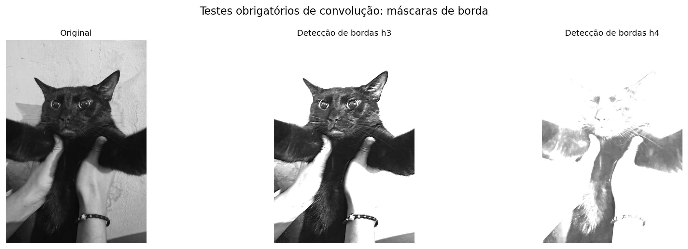

Resultados das máscaras `h3` e `h4` do enunciado. Para visualização, foi usado o módulo da resposta; respostas de máscaras com soma não nula podem surgir mesmo em regiões de intensidade constante.

## Instalação e execução

Requisitos: **Python 3**, suporte a **Tkinter** e as dependências do `requirements.txt`.

Clone o repositório e entre na pasta:

```bash
git clone https://github.com/MariMeng/laboratorio-processamento-de-imagens.git
cd laboratorio-processamento-de-imagens
```

Opcionalmente, crie um ambiente virtual:

```bash
python3 -m venv .venv
source .venv/bin/activate
```

Instale as bibliotecas:

```bash
python -m pip install -r requirements.txt
```

No Ubuntu/Debian, se houver erro ao importar `tkinter`, instale também o suporte gráfico pelo sistema:

```bash
sudo apt install python3-tk
```

Inicie o aplicativo:

```bash
python main.py
```

## Como usar

1. Clique em **Abrir imagem principal** e selecione uma imagem; para dissolve, selecione também uma **segunda imagem**.
2. Escolha o grupo e a operação no painel lateral, ajuste os parâmetros e clique em **Aplicar operação**.
3. Compare o original com o resultado. Quando houver respostas intermediárias, escolha a resposta desejada na lista de seleção.
4. Clique em **Salvar resultado selecionado** para gravar o processamento em arquivo.

Em imagens grandes, algumas operações podem demorar, pois as vizinhanças e máscaras são percorridas explicitamente em Python.

## Organização dos arquivos

```text
laboratorio-processamento-de-imagens/
├── main.py                    # Inicia o aplicativo
├── interface.py               # Interface gráfica
├── image.py                   # Leitura e conversão de imagens
├── algebraic-operations.py    # Dissolve uniforme e não uniforme
├── intensity.py               # Transformações de intensidade
├── histogram.py               # Expansão e equalização
├── filter.py                  # Média e mediana
├── contraste.py               # Contraste adaptativo
├── edge_detection.py          # Roberts, Sobel, Kirsch e Laplaciano
├── agucamento.py              # Laplaciano e High Boost
├── convolucao.py              # Convolução genérica
├── requirements.txt
└── docs/
    └── imagens/              # Capturas e resultados exibidos aqui
```

## Detalhes de implementação

- A imagem é processada em **tons de cinza de 8 bits** (modo `L` no Pillow).
- Os cálculos intermediários usam `float64` quando necessário para evitar truncamento e preservar sinais.
- As bordas são tratadas por **reflexão** nos filtros e detectores; a convolução genérica também aceita replicação e preenchimento com zeros.
- A convolução matemática inverte a máscara em dois eixos. A função auxiliar dos detectores de bordas aplica **correlação espacial**, conforme as máscaras definidas no código.
- A saída de imagem em 8 bits é limitada ao intervalo **[0, 255]**. Para visualizar respostas assinadas, podem ser usadas normalizações específicas.
- O laboratório funciona **localmente**, sem serviços externos.

## Contexto acadêmico

Projeto desenvolvido para a disciplina de **Processamento de Imagens**, do curso de **Ciência da Computação — Universidade Federal de Rondônia (UNIR)**.

As figuras são registros de testes de implementação e ilustrações do comportamento dos algoritmos. A interpretação dos resultados depende da imagem e dos parâmetros utilizados; o sistema é destinado a fins acadêmicos e experimentais.
